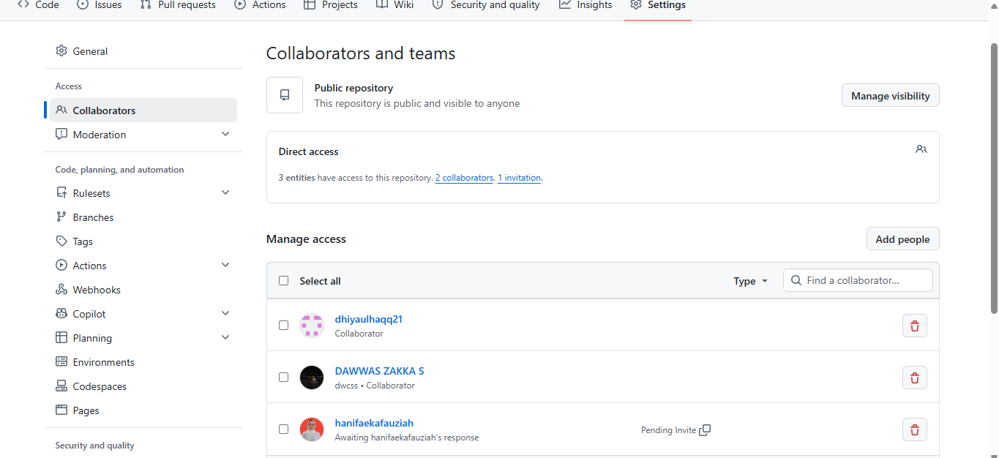
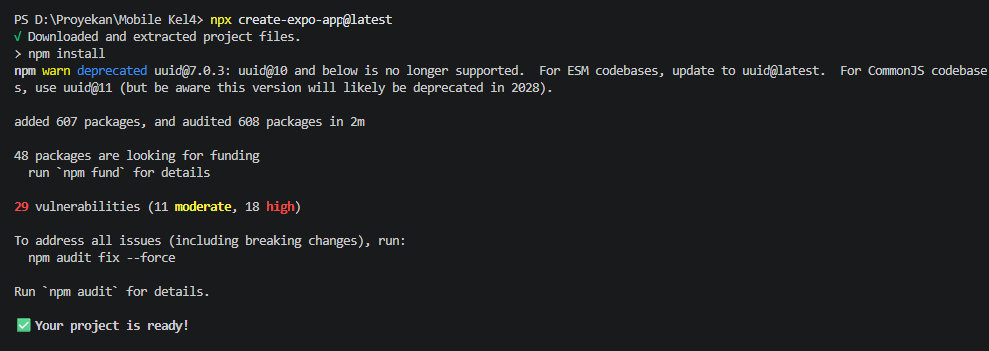
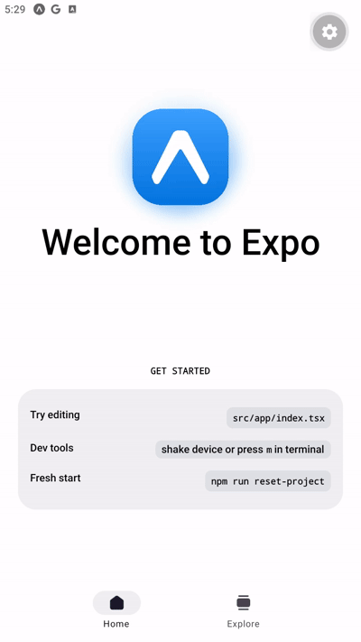
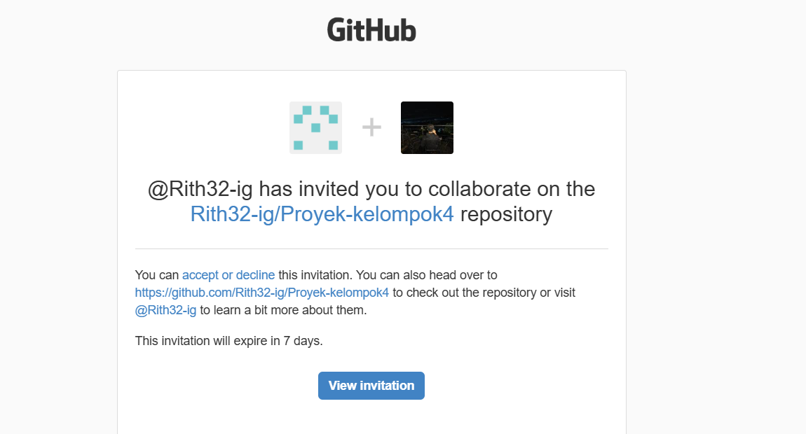
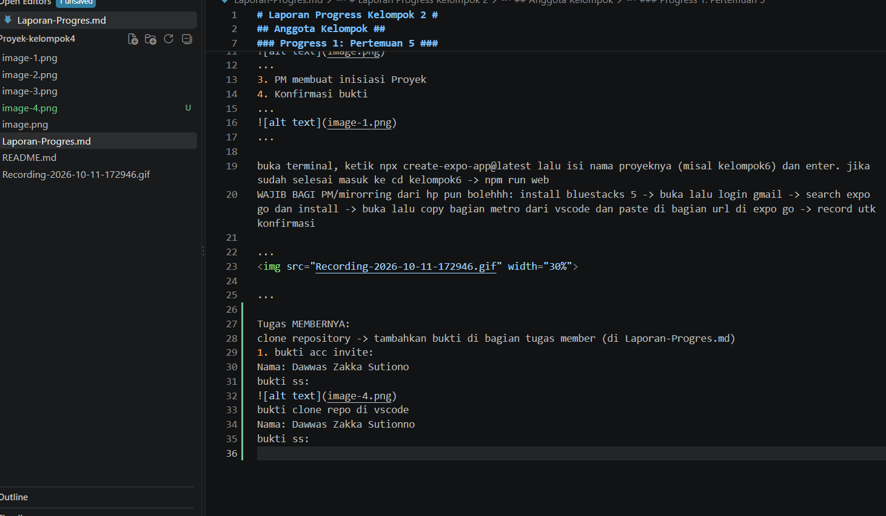
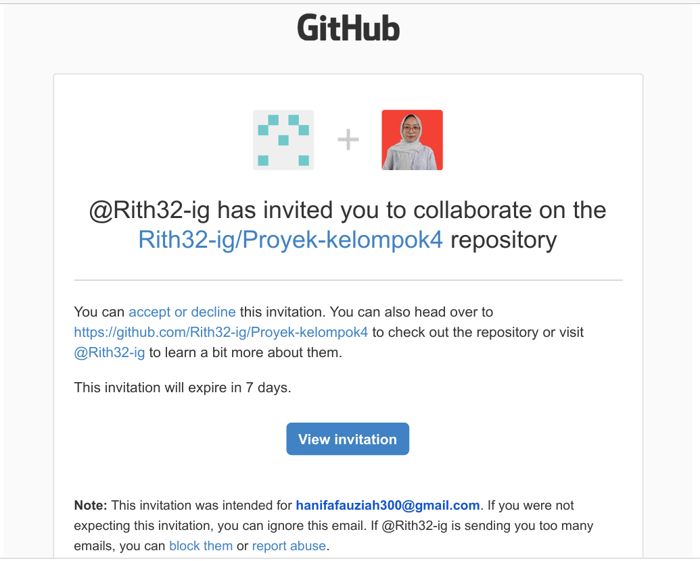
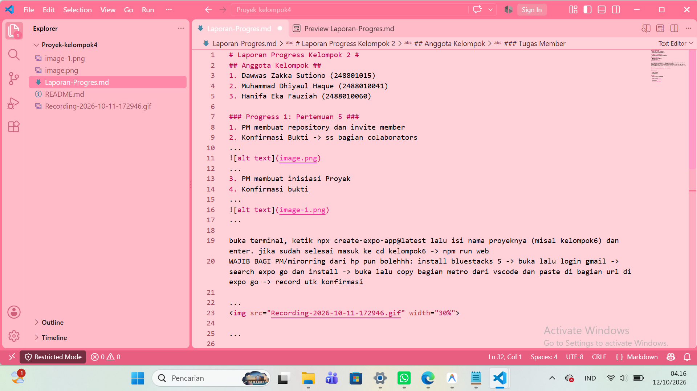

# Laporan Progress Kelompok 4 #
## Anggota Kelompok ##
1. Moh.Farid Ilham Ghifari (2488010066)
2. Dawwas Zakka Sutiono (248801015)
3. Muhammad Dhiyaul Haque (2488010041)
4. Hanifa Eka Fauziah (2488010060)

### Progress 1: Pertemuan 5 ###
1. PM membuat repository dan invite member
2. Konfirmasi Bukti -> ss bagian colaborators
...

...
3. PM membuat inisiasi Proyek
4. Konfirmasi bukti 
...

...

...

...

<<<<<<< HEAD
Tugas MEMBERNYA:
clone repository -> tambahkan bukti di bagian tugas member (di Laporan-Progres.md)
1. bukti acc invite:
Nama: Dawwas Zakka Sutiono
bukti ss:

bukti clone repo di vscode
Nama: Dawwas Zakka Sutionno
bukti ss: 

1. bukti acc invite:
Nama: Hanifa Eka Fauziah
bukti ss:

bukti clone repo di vscode
Nama: Hanifa Eka Fauziah
bukti ss: 

=======
# NOTULENSI DISKUSI PROYEK KELOMPOK 4 #
Nama Kelompok	: Kelompok 4
Hari/Tanggal	: Minggu, 11 Oktober 2026
Waktu           : 16.00 – 17.00 WIB
Tempat/Media	: Google Meet

## Agenda Diskusi ##
1.	Mengusulkan ide tema aplikasi mobile
2.	Menentukan target pengguna aplikasi

## Daftar Ide Tema ##

### Hanifa ###
Mengajukan :
1)	Aplikasi Booking Lapangan
    Target Pengguna: Owner dan Umum

2)	Aplikasi Manajemen Gym
    Target pengguna: Owner dan Member Gym

### Dawwas ###
Mengajukan:
1)	Aplikasi Manejemen Kos
    Target pengguna: Pemilik dan Penghuni Kos

### Farid ###
Mengajukan:
1)	Aplikasi Trip Cirebon
    Target Pengguna: Umun

### Dhiyaul ###
Mengajukan:
1)	Aplikasi Absensi Ngaji
    Target Pengguna: Santri dan Ustad

## Hasil dan Keputusan ##
Belum ditentukan
Tema yang diusulkan: 
Alasan pemilihan: