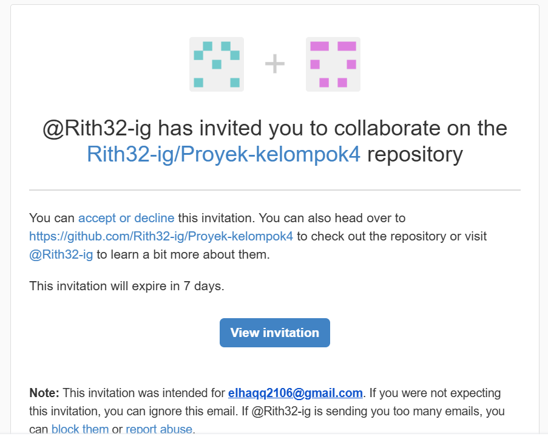
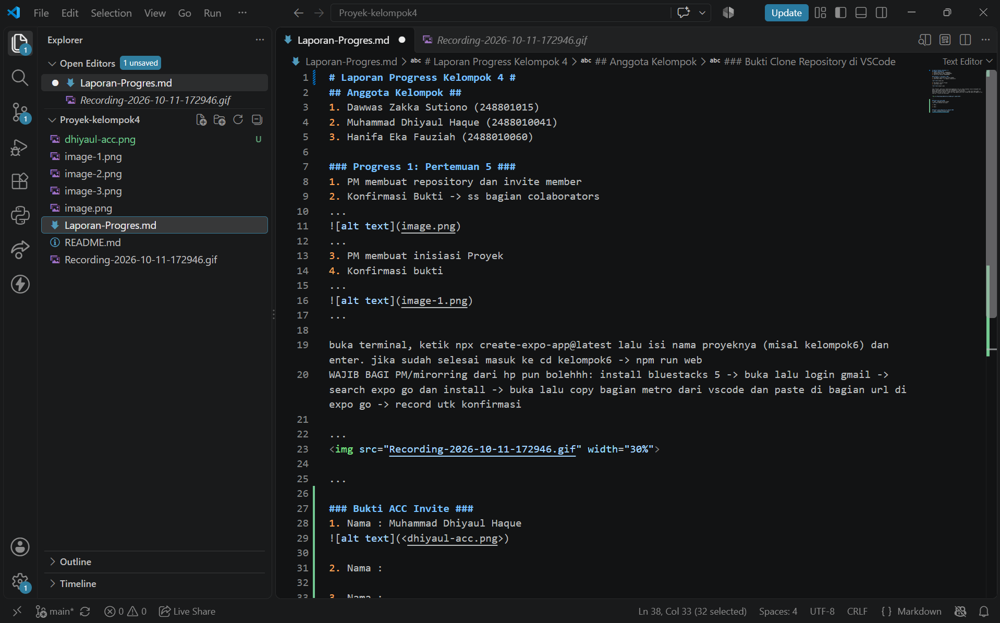

# Laporan Progress Kelompok 4 #
## Anggota Kelompok ##
1. Moh.Farid Ilham Ghifari (2488010066)
2. Dawwas Zakka Sutiono (248801015)
3. Muhammad Dhiyaul Haque (2488010041)
4. Hanifa Eka Fauziah (2488010060)

### Progress 1: Pertemuan 5 ###
1. PM membuat repository dan invite member
2. Konfirmasi Bukti -> ss bagian colaborators
...

...
3. PM membuat inisiasi Proyek
4. Konfirmasi bukti 
...

...

...

...

Tugas MEMBER
**Bukti Acc Invite**
1. Nama: Dawwas Zakka Sutiono
Tugas MEMBERNYA:
clone repository -> tambahkan bukti di bagian tugas member (di Laporan-Progres.md)
1. bukti acc invite:
Nama: Dawwas Zakka Sutiono
bukti ss:

2. Nama: Muhammad Dhiyaul Haque
bukti :

3. Nama: 

**bukti clone repo di vscode**
1. Nama: Dawwas Zakka Sutionno
bukti ss: 

2. Nama : Muhammad Dhiyaul Haque
bukti ss:

3. 
4. 
